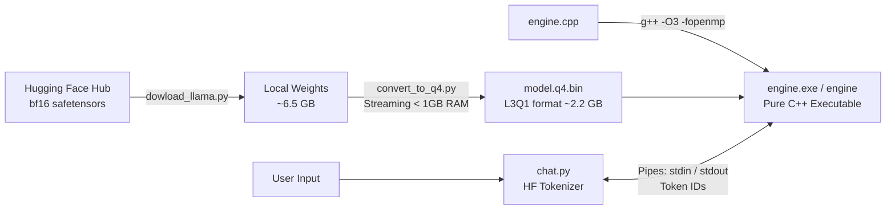

# Llama 3.2 C++ Inference Engine

A lightweight, high-performance CPU inference engine written in pure C++ (with OpenMP) and accompanied by Python tooling to download, quantize, and interact with Meta's **Llama 3.2** (1B and 3B Instruct) models locally with minimal memory footprint.

---

## Highlights

- **Zero Heavy C++ Dependencies**: Standalone C++17 implementation using standard libraries and OpenMP for multi-core parallelism—no CUDA, PyTorch, BLAS, or heavyweight third-party runtimes required.
- **Custom 4-Bit Grouped Quantization (`L3Q1`)**: Shrinks Llama 3.2 3B from ~6.5 GB (`bfloat16`) down to ~2.2 GB, enabling fast, local execution even on machines with 8 GB of RAM.
- **Low-Memory Streaming Quantization**: Streams weights in blocks via `np.memmap` keeping conversion RAM usage strictly below 1 GB.
- **Complete Transformer Architecture**: Full implementation of:
  - Grouped-Query Attention (GQA)
  - Pre-computed Rotary Position Embeddings (RoPE) with Llama 3.x frequency scaling
  - RMSNorm & SwiGLU activation functions
  - Autoregressive generation with KV caching
- **Interactive Chat Frontend (`chat.py`)**: Connects Hugging Face `tokenizers` to the compiled C++ engine over standard I/O with streaming token decoding, multi-byte UTF-8 character assembly, and official Llama 3 chat template handling.
- **Configurable Sampling**: Support for greedy argmax, temperature, top-p (nucleus), top-k sampling, and custom stop tokens.

---

## Architecture & Workflow



---

## Project Structure

```text
llama3.2/
├── engine.cpp          # Core C++ inference engine with OpenMP multi-threading
├── chat.py             # Interactive chat interface & token streaming wrapper
├── convert_to_q4.py    # Memory-efficient safetensors-to-Q4 model quantizer
├── dowload_llama.py    # Gated Hugging Face weight downloader
├── src/inference/      # Placeholder Python package from `uv init` (not used by the engine)
├── pyproject.toml      # Python dependencies and metadata (uv)
├── uv.lock             # Deterministic lockfile for dependencies
├── .python-version     # Python version pinned for uv (3.14)
├── .vscode/            # VS Code C/C++ IntelliSense settings
├── .gitignore          # Ignores models/, engine.exe, model.q4.bin, and caches
└── README.md           # Project documentation
```

---

## Prerequisites

1. **C++ Compiler**: A C++17 compliant compiler with OpenMP support:
   - **Windows**: MinGW-w64 (`g++`) or MSVC (`cl.exe`).
   - **Linux / macOS**: `g++` or `clang++`.
2. **Python**: `pyproject.toml` and `.python-version` pin Python 3.14 for `uv`. The scripts themselves only use the standard library plus `numpy`, `tokenizers`, and `huggingface_hub`, so an older Python with `pip` should also work (untested).
3. **Hugging Face Account**:
   - Access granted for [meta-llama/Llama-3.2-3B-Instruct](https://huggingface.co/meta-llama/Llama-3.2-3B-Instruct) or [meta-llama/Llama-3.2-1B-Instruct](https://huggingface.co/meta-llama/Llama-3.2-1B-Instruct).
   - A Hugging Face Read Token (starts with `hf_...`).

---

## Quickstart

### 1. Setup Python Environment

Clone the repository and install the dependencies:

```bash
git clone https://github.com/adieesingh/llama3.2.git
cd llama3.2
```

Using [`uv`](https://github.com/astral-sh/uv) (recommended):
```bash
uv sync
```

> `pyproject.toml` currently lists only `huggingface-hub` and `tokenizers`. `convert_to_q4.py` also needs `numpy`, so run `uv add numpy` (or `uv pip install numpy`) before step 3.

Or standard `pip`:
```bash
pip install huggingface_hub tokenizers numpy
```

---

### 2. Download Model Weights

Run `dowload_llama.py` to retrieve the model checkpoint. The downloader checks available disk space, skips redundant `original/` weights, and fetches only necessary config and safetensor files:

```bash
# Set your token as an environment variable (or paste it when prompted):
export HF_TOKEN="hf_..."       # Linux / macOS
$env:HF_TOKEN="hf_..."         # Windows PowerShell

# Download Llama 3.2 3B Instruct (default: models/llama-3.2-3b-instruct)
python dowload_llama.py

# Or download Llama 3.2 1B Instruct:
python dowload_llama.py --repo meta-llama/Llama-3.2-1B-Instruct --out models/llama-3.2-1b-instruct
```

---

### 3. Quantize Weights to 4-bit (`model.q4.bin`)

Quantize the `safetensors` checkpoint into the custom `L3Q1` binary format:

```bash
python convert_to_q4.py models/llama-3.2-3b-instruct model.q4.bin
```

> **Memory Efficiency**: Conversion processes weights in row chunks, ensuring RAM consumption stays under 1 GB throughout the entire quantization process.

---

### 4. Compile the C++ Engine

Compile `engine.cpp` with `-O3` optimizations and OpenMP:

#### On Windows (MinGW-w64 GCC):
```powershell
g++ -O3 -fopenmp -static engine.cpp -o engine.exe
```
> The `-static` flag bundles runtime dependencies so the executable can run standalone without requiring MinGW libraries in your `PATH`.

#### On Linux / macOS (GCC / Clang):
```bash
g++ -O3 -fopenmp engine.cpp -o engine
```

#### On Windows (MSVC):
```powershell
cl /O2 /openmp /EHsc engine.cpp /Fe:engine.exe
```

---

### 5. Start Chatting

Launch the interactive terminal chat:

#### On Windows:
```powershell
python chat.py --model model.q4.bin --tokenizer models/llama-3.2-3b-instruct/tokenizer.json --engine .\engine.exe
```

#### On Linux / macOS:
```bash
python chat.py --model model.q4.bin --tokenizer models/llama-3.2-3b-instruct/tokenizer.json --engine ./engine
```

#### Interactive Commands:
- Type your prompt and press **Enter** to chat.
- `/reset` — Clears conversation history and resets the KV cache.
- `/exit` — Terminates the session.

---

## Advanced Options

### Single Prompt Mode
Run a one-off query without entering the interactive loop:
```powershell
python chat.py --model model.q4.bin --tokenizer models/llama-3.2-3b-instruct/tokenizer.json --engine .\engine.exe --prompt "Explain the theory of relativity in 3 bullet points."
```

### Parameter Tuning
Adjust temperature, top-p sampling, context length, system prompt, or thread count:
```powershell
python chat.py `
  --model model.q4.bin `
  --tokenizer models/llama-3.2-3b-instruct/tokenizer.json `
  --engine .\engine.exe `
  --system "You are a concise technical assistant." `
  --ctx 4096 `
  --maxnew 512 `
  --temp 0.7 `
  --topp 0.9 `
  --threads 8
```

### CLI Arguments Reference

| Script | Option | Default | Description |
| :--- | :--- | :--- | :--- |
| `chat.py` | `--model` | *(required)* | Path to quantized `model.q4.bin` |
| `chat.py` | `--tokenizer` | *(required)* | Path to `tokenizer.json` |
| `chat.py` | `--engine` | `./engine` | Path to compiled engine executable |
| `chat.py` | `--system` | `"You are a helpful assistant."` | System prompt |
| `chat.py` | `--ctx` | `2048` | Maximum context window tokens |
| `chat.py` | `--maxnew` | `512` | Maximum generated tokens per turn |
| `chat.py` | `--temp` | `0.6` | Sampling temperature (`0.0` for greedy) |
| `chat.py` | `--topp` | `0.9` | Top-p nucleus sampling cutoff |
| `chat.py` | `--threads` | `0` | OpenMP threads (`0` = auto-detect) |
| `chat.py` | `--seed` | `None` | Random seed for sampling reproducibility |
| `chat.py` | `--prompt` | `None` | Execute a single prompt and exit |
| `chat.py` | `--raw` | `False` | Raw text continuation without chat templates |
| `chat.py` | `--stop-ids` | `None` | Comma-separated token IDs that end an answer (default: `<|eot_id|>`, `<|end_of_text|>`, `<|eom_id|>` looked up from the tokenizer) |
| `engine` | `model.bin` | *(required)* | First positional argument: path to the `L3Q1` model file |
| `engine` | `--ctx` / `--maxnew` | `2048` / `512` | Context window / max generated tokens per turn |
| `engine` | `--temp` / `--topp` | `0.6` / `0.9` | Sampling temperature / nucleus cutoff |
| `engine` | `--topk` | `40` | Top-k candidate sampling limit (not exposed by `chat.py`) |
| `engine` | `--seed` | time-based | Random seed |
| `engine` | `--threads` | `0` | OpenMP threads (`0` = auto) |
| `engine` | `--stop` | none | Comma-separated token IDs that stop generation (`chat.py` fills this in for you) |
| `engine` | `--dump-logits` | `false` | Dump prompt logits and exit (for verification) |

`chat.py` forwards `--ctx`, `--maxnew`, `--temp`, `--topp`, `--threads`, and `--seed` to the engine, so you normally only run the engine through `chat.py`.

---

## Engine Protocol (stdin / stdout)

The engine only understands token IDs; `chat.py` handles text, templates, and tokenization. You can also drive it directly:

| Direction | Line | Meaning |
| :--- | :--- | :--- |
| in | `12 345 6789 ...` | Space-separated token IDs to append to the conversation; generation starts immediately |
| in | `RESET` | Clear the KV cache (engine replies `OK`) |
| in | `QUIT` | Exit the engine |
| out | `T <id>` | One generated token ID (streamed) |
| out | `END stop` / `END length` | Generation finished on a stop token / on hitting `--maxnew` |
| out | `ERR <message>` | Empty input, token ID out of range, or context full (send `RESET`) |

Load time and prompt / generation speed (tokens per second) are printed to **stderr**.

---

## File Format: `L3Q1` Specification

The `L3Q1` binary format uses little-endian byte ordering:

| Segment | Type | Description |
| :--- | :--- | :--- |
| **Magic Header** | `char[4]` | Identifier ASCII bytes `"L3Q1"` |
| **Configuration** | `int32[9]` | `dim`, `hidden`, `n_layers`, `n_heads`, `n_kv_heads`, `head_dim`, `vocab`, `max_seq`, `group_size` (32) |
| **RMS Norm Epsilon**| `float32` | Layer norm epsilon (e.g., `1e-5`) |
| **RoPE Inverted Frequencies** | `float32[head_dim/2]` | Precomputed rotary frequencies with Llama 3 scaling |
| **Token Embeddings**| `int8[vocab * dim]` + `float32[vocab * dim / 32]` | 8-bit quantized token embeddings with group size 32 |
| **Layer Blocks (x `n_layers`)** | Mixed | Attention norm (`float32[dim]`), FFN norm (`float32[dim]`), followed by 4-bit packed weights (`wq`, `wk`, `wv`, `wo`, `wg`, `wu`, `wd`) with corresponding `float32` scale factors |
| **Final RMS Norm** | `float32[dim]` | Output normalization weights |

---

## Memory & Performance Notes

| Model | Original Size (bf16) | Quantized Size (L3Q1) | Conversion Peak RAM | Minimum Recommended RAM |
| :--- | :--- | :--- | :--- | :--- |
| **Llama 3.2 1B** | ~2.5 GB | ~0.8 GB | < 1 GB | 4 GB |
| **Llama 3.2 3B** | ~6.5 GB | ~2.2 GB | < 1 GB | 8 GB |

---

## Limitations

- Only models with **tied embeddings** are supported (Llama 3.2 1B and 3B). The converter exits if it finds a separate `lm_head`.
- Only the Llama 3.x (`llama3`) RoPE scaling type is supported.
- Source weights must be `bf16`, `f16`, or `f32` safetensors; every weight matrix needs a column count divisible by the group size (32).
- CPU only, single conversation at a time (one KV cache).

---

## License

Released under the MIT License. *(Note: no `LICENSE` file is in the repository yet; add one so the license is explicit.)*

Model weights are subject to Meta's [Llama 3.2 Community License](https://github.com/meta-llama/llama-models/blob/main/models/llama3_2/LICENSE).
