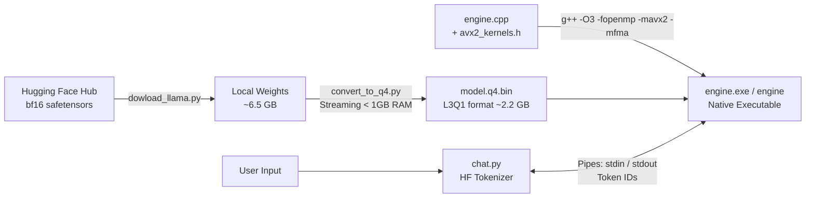

# Llama 3.2 C++ Inference Engine

A lightweight CPU inference engine written in pure C++ (with OpenMP and optional AVX2) and accompanied by Python tooling to download, quantize, and interact with Meta's **Llama 3.2** (1B and 3B Instruct) models locally with a minimal memory footprint.

---

## Highlights

- **Zero Heavy C++ Dependencies**: Standalone C++17 implementation using standard libraries and OpenMP for multi-core parallelism. No CUDA, PyTorch, BLAS, or heavyweight third-party runtimes.
- **AVX2 + FMA Kernels (optional)**: Hand-written SIMD matrix-vector kernels (`avx2_kernels.h`) for the 4-bit and 8-bit weights. Enabled at compile time with `-mavx2 -mfma`; without those flags the engine falls back to the portable scalar code.
- **Custom 4-Bit Grouped Quantization (`L3Q1`)**: Shrinks Llama 3.2 3B from ~6.5 GB (`bfloat16`) to ~2.2 GB, enabling local execution on machines with 8 GB of RAM.
- **Low-Memory Streaming Quantization**: Streams weights in blocks via `np.memmap`, keeping conversion RAM usage below 1 GB.
- **Complete Transformer Architecture**:
  * Grouped-Query Attention (GQA)
  * Pre-computed Rotary Position Embeddings (RoPE) with Llama 3.x frequency scaling
  * RMSNorm and SwiGLU activation
  * Autoregressive generation with KV caching
- **Interactive Chat Frontend (`chat.py`)**: Connects Hugging Face `tokenizers` to the compiled C++ engine over standard I/O, with streaming token decoding, multi-byte UTF-8 assembly, and the official Llama 3 chat template.
- **Configurable Sampling**: Greedy argmax, temperature, top-p (nucleus), top-k, and custom stop tokens.

---

## Architecture & Workflow



---

## Project Structure

```
llama3.2/
├── engine.cpp            # Core C++ inference engine with OpenMP multi-threading
├── avx2_kernels.h        # AVX2 + FMA matvec kernels (int4 and int8 weights)
├── bench_avx2.cpp        # Scalar vs AVX2 matvec benchmark (Llama 3.2 3B shapes)
├── apply_avx2_patch.py   # One-time helper that wires avx2_kernels.h into engine.cpp
├── chat.py               # Interactive chat interface & token streaming wrapper
├── convert_to_q4.py      # Memory-efficient safetensors-to-Q4 model quantizer
├── dowload_llama.py      # Gated Hugging Face weight downloader
├── src/inference/        # Placeholder Python package from `uv init` (not used by the engine)
├── pyproject.toml        # Python dependencies and metadata (uv)
├── uv.lock               # Deterministic lockfile for dependencies
├── .python-version       # Python version pinned for uv (3.14)
├── .vscode/              # VS Code C/C++ IntelliSense settings
├── .gitignore            # Ignores models/, engine.exe, model.q4.bin, and caches
└── README.md             # Project documentation
```

---

## Prerequisites

1. **C++ Compiler**: A C++17 compliant compiler with OpenMP support:
   - **Windows**: MinGW-w64 (`g++`) or MSVC (`cl.exe`).
   - **Linux / macOS**: `g++` or `clang++`.
   - For the AVX2 build, the CPU must support AVX2 and FMA (any Intel Haswell / AMD Zen or newer).
2. **Python**: `pyproject.toml` and `.python-version` pin Python 3.14 for `uv`. The scripts only use the standard library plus `numpy`, `tokenizers`, and `huggingface_hub`, so an older Python with `pip` should also work (untested).
3. **Hugging Face Account**:
   - Access granted for [meta-llama/Llama-3.2-3B-Instruct](https://huggingface.co/meta-llama/Llama-3.2-3B-Instruct) or [meta-llama/Llama-3.2-1B-Instruct](https://huggingface.co/meta-llama/Llama-3.2-1B-Instruct).
   - A Hugging Face Read Token (starts with `hf_...`).

---

## Quickstart

### 1. Setup Python Environment

```
git clone https://github.com/adieesingh/llama3.2.git
cd llama3.2
```

Using [`uv`](https://github.com/astral-sh/uv) (recommended):

```
uv sync
```

> `pyproject.toml` currently lists only `huggingface-hub` and `tokenizers`. `convert_to_q4.py` also needs `numpy`, so run `uv add numpy` (or `uv pip install numpy`) before step 3.

Or standard `pip`:

```
pip install huggingface_hub tokenizers numpy
```

---

### 2. Download Model Weights

```
# Set your token as an environment variable (or paste it when prompted):
export HF_TOKEN="hf_..."       # Linux / macOS / Git Bash
$env:HF_TOKEN="hf_..."         # Windows PowerShell

# Download Llama 3.2 3B Instruct (default: models/llama-3.2-3b-instruct)
python dowload_llama.py

# Or download Llama 3.2 1B Instruct:
python dowload_llama.py --repo meta-llama/Llama-3.2-1B-Instruct --out models/llama-3.2-1b-instruct
```

The downloader checks available disk space, skips the redundant `original/` weights, and fetches only the config and safetensor files.

---

### 3. Quantize Weights to 4-bit (`model.q4.bin`)

```
python convert_to_q4.py models/llama-3.2-3b-instruct model.q4.bin
```

> **Memory Efficiency**: Conversion processes weights in row chunks, so RAM stays under 1 GB for the whole run. `model.q4.bin` is git-ignored, so every clone has to generate its own.

---

### 4. Compile the C++ Engine

#### Recommended: AVX2 + FMA build

**Windows (MinGW-w64 GCC):**
```
g++ -O3 -fopenmp -mavx2 -mfma -static engine.cpp -o engine.exe
```

**Linux / macOS (GCC / Clang):**
```
g++ -O3 -fopenmp -mavx2 -mfma engine.cpp -o engine
```

**Windows (MSVC):**
```
cl /O2 /openmp /arch:AVX2 /EHsc engine.cpp /Fe:engine.exe
```
(MSVC does not define `__FMA__` with `/arch:AVX2` alone, so the AVX2 kernels stay disabled there and the scalar path is used. Use MinGW or GCC/Clang for the SIMD build.)

#### Portable scalar build (any CPU)

```
g++ -O3 -fopenmp -static engine.cpp -o engine.exe      # Windows (MinGW)
g++ -O3 -fopenmp engine.cpp -o engine                  # Linux / macOS
```

> The `-static` flag bundles runtime dependencies so the executable runs standalone without MinGW libraries on your `PATH`.

> **Tip:** keep the scalar build as `engine_old.exe` next to the AVX2 `engine.exe` so you can compare speed with the same prompt.

---

### 5. Start Chatting

#### PowerShell (Windows):
```
python chat.py --model model.q4.bin --tokenizer models/llama-3.2-3b-instruct/tokenizer.json --engine .\engine.exe
```

#### Git Bash / Linux / macOS:
```
python chat.py --model model.q4.bin --tokenizer models/llama-3.2-3b-instruct/tokenizer.json --engine ./engine.exe
```

> In Git Bash, use a forward slash (`./engine.exe`). A backslash is treated as an escape character and breaks the path.

#### Interactive Commands:

- Type your prompt and press **Enter** to chat.
- `/reset` clears conversation history and resets the KV cache.
- `/exit` terminates the session.

---

## Advanced Options

### Single Prompt Mode

```
python chat.py --model model.q4.bin --tokenizer models/llama-3.2-3b-instruct/tokenizer.json --engine ./engine.exe --prompt "Explain the theory of relativity in 3 bullet points."
```

### Parameter Tuning

```
python chat.py \
  --model model.q4.bin \
  --tokenizer models/llama-3.2-3b-instruct/tokenizer.json \
  --engine ./engine.exe \
  --system "You are a concise technical assistant." \
  --ctx 4096 \
  --maxnew 512 \
  --temp 0.7 \
  --topp 0.9 \
  --threads 8
```

### CLI Arguments Reference

| Script    | Option               | Default                          | Description                                                                      |
| --------- | -------------------- | -------------------------------- | -------------------------------------------------------------------------------- |
| `chat.py` | `--model`            | *(required)*                     | Path to quantized `model.q4.bin`                                                 |
| `chat.py` | `--tokenizer`        | *(required)*                     | Path to `tokenizer.json`                                                         |
| `chat.py` | `--engine`           | `./engine`                       | Path to compiled engine executable                                               |
| `chat.py` | `--system`           | `"You are a helpful assistant."` | System prompt                                                                    |
| `chat.py` | `--ctx`              | `2048`                           | Maximum context window tokens                                                    |
| `chat.py` | `--maxnew`           | `512`                            | Maximum generated tokens per turn                                                |
| `chat.py` | `--temp`             | `0.6`                            | Sampling temperature (`0.0` for greedy)                                          |
| `chat.py` | `--topp`             | `0.9`                            | Top-p nucleus sampling cutoff                                                    |
| `chat.py` | `--threads`          | `0`                              | OpenMP threads (`0` = auto-detect)                                               |
| `chat.py` | `--seed`             | `None`                           | Random seed for sampling reproducibility                                         |
| `chat.py` | `--prompt`           | `None`                           | Execute a single prompt and exit                                                 |
| `chat.py` | `--raw`              | `False`                          | Raw text continuation without chat templates                                     |
| `chat.py` | `--stop-ids`         | `None`                           | Comma-separated token IDs that end an answer (default: the Llama 3 end tokens)   |
| `engine`  | `model.bin`          | *(required)*                     | First positional argument: path to the `L3Q1` model file                         |
| `engine`  | `--ctx` / `--maxnew` | `2048` / `512`                   | Context window / max generated tokens per turn                                   |
| `engine`  | `--temp` / `--topp`  | `0.6` / `0.9`                    | Sampling temperature / nucleus cutoff                                            |
| `engine`  | `--topk`             | `40`                             | Top-k candidate sampling limit (not exposed by `chat.py`)                        |
| `engine`  | `--seed`             | time-based                       | Random seed                                                                      |
| `engine`  | `--threads`          | `0`                              | OpenMP threads (`0` = auto)                                                      |
| `engine`  | `--stop`             | none                             | Comma-separated token IDs that stop generation (`chat.py` fills this in for you) |
| `engine`  | `--dump-logits`      | `false`                          | Dump prompt logits and exit (for verification)                                   |

`chat.py` forwards `--ctx`, `--maxnew`, `--temp`, `--topp`, `--threads`, and `--seed` to the engine, so you normally only run the engine through `chat.py`.

---

## Engine Protocol (stdin / stdout)

The engine only understands token IDs; `chat.py` handles text, templates, and tokenization. You can also drive it directly:

| Direction | Line                      | Meaning                                                                                |
| --------- | ------------------------- | -------------------------------------------------------------------------------------- |
| in        | `12 345 6789 ...`         | Space-separated token IDs to append to the conversation; generation starts immediately |
| in        | `RESET`                   | Clear the KV cache (engine replies `OK`)                                               |
| in        | `QUIT`                    | Exit the engine                                                                        |
| out       | `T <id>`                  | One generated token ID (streamed)                                                      |
| out       | `END stop` / `END length` | Generation finished on a stop token / on hitting `--maxnew`                            |
| out       | `ERR <message>`           | Empty input, token ID out of range, or context full (send `RESET`)                     |

Load time and prompt / generation speed (tokens per second) are printed to **stderr**, for example:

```
[engine] prompt 24 tok in 5.1s (4.7 tok/s) | generated 120 tok in 30.2s (4.0 tok/s) | cache 144/2048
```

---

## File Format: `L3Q1` Specification

The `L3Q1` binary format uses little-endian byte ordering:

| Segment                         | Type                                              | Description                                                                                                                                                                        |
| ------------------------------- | ------------------------------------------------- | ---------------------------------------------------------------------------------------------------------------------------------------------------------------------------------- |
| **Magic Header**                | `char[4]`                                         | Identifier ASCII bytes `"L3Q1"`                                                                                                                                                    |
| **Configuration**               | `int32[9]`                                        | `dim`, `hidden`, `n_layers`, `n_heads`, `n_kv_heads`, `head_dim`, `vocab`, `max_seq`, `group_size` (32)                                                                            |
| **RMS Norm Epsilon**            | `float32`                                         | Layer norm epsilon (e.g., `1e-5`)                                                                                                                                                  |
| **RoPE Inverted Frequencies**   | `float32[head_dim/2]`                             | Precomputed rotary frequencies with Llama 3 scaling                                                                                                                                |
| **Token Embeddings**            | `int8[vocab * dim]` + `float32[vocab * dim / 32]` | 8-bit quantized token embeddings with group size 32                                                                                                                                |
| **Layer Blocks (x `n_layers`)** | Mixed                                             | Attention norm (`float32[dim]`), FFN norm (`float32[dim]`), followed by 4-bit packed weights (`wq`, `wk`, `wv`, `wo`, `wg`, `wu`, `wd`) with corresponding `float32` scale factors |
| **Final RMS Norm**              | `float32[dim]`                                    | Output normalization weights                                                                                                                                                       |

**4-bit packing:** weights are in groups of 32 that share one `float32` scale. Within a group, byte `j` (0..15) stores weight `j` in the low nibble and weight `j+16` in the high nibble, each offset by 8 (range -8..7).

---

## Performance

### Memory

| Model            | Original Size (bf16) | Quantized Size (L3Q1) | Conversion Peak RAM | Minimum Recommended RAM |
| ---------------- | -------------------- | --------------------- | ------------------- | ----------------------- |
| **Llama 3.2 1B** | ~2.5 GB              | ~0.8 GB               | < 1 GB              | 4 GB                    |
| **Llama 3.2 3B** | ~6.5 GB              | ~2.2 GB               | < 1 GB              | 8 GB                    |

### Speed

Measured on an AMD Ryzen 5 5500U laptop (Windows, 8 GB RAM) with Llama 3.2 3B: about **4 tokens/s** generation. Your numbers will vary with CPU, RAM speed, thread count, and context length.

Decoding is mostly **memory-bandwidth bound**: every generated token streams all ~2.2 GB of weights from RAM, so adding threads past the point where memory is saturated stops helping. Try `--threads` equal to your physical core count and compare against a higher value.

**Generation slows as the context grows.** Each new token attends to every earlier token, so attention work and KV-cache reads increase with the position. The KV cache is stored as `float32` (about 230 KB per token for 3B), so a 2000-token conversation holds roughly 460 MB of cache that is read for every new token. Weight matmuls cost the same at any position.

### AVX2 kernels

The scalar code in `engine.cpp` converts each 4-bit weight to a float and multiplies one value at a time. `avx2_kernels.h` instead:

1. quantizes the activation vector to int8 once per matvec (one scale per group of 32),
2. unpacks 32 nibbles into a single 256-bit register,
3. multiplies and accumulates 32 int8 pairs per instruction (`maddubs` + `madd`),
4. applies the combined weight and activation scale with one FMA.

Rounding the activations to int8 introduces roughly 0.5% relative error in each matvec output, so greedy (`--temp 0`) generations can diverge slightly from the scalar build. Compare `--dump-logits` from both builds if you need to verify.

Run the micro-benchmark (Llama 3.2 3B matrix shapes, scalar vs AVX2, with an error check):

```
g++ -O3 -fopenmp -mavx2 -mfma -static bench_avx2.cpp -o bench_avx2.exe
./bench_avx2.exe            # options: --iters N  --threads N  --no-head
```

It prints per-matrix timings, speedup, effective memory bandwidth, and relative error. Compile and run it as two separate commands.

### Comparing builds

```
./engine_old.exe   # scalar build
./engine.exe       # AVX2 build
```

Run the same prompt with `--temp 0` on each and compare the `generated ... tok/s` line on stderr.

---

## Troubleshooting

| Symptom | Cause / fix |
| ------- | ----------- |
| `FileNotFoundError: [WinError 2]` from `chat.py` | `engine.exe` was not built, or the path is wrong. In Git Bash use `./engine.exe`, not `.\engine.exe`. |
| `error: cannot open model.q4.bin` | The model file is git-ignored; generate it with `convert_to_q4.py` (steps 2-3). |
| `cannot find .bench_avx2.exe` at link time | Two commands were pasted on one line. Run the build and the executable separately. |
| `error: not an L3Q1 file` | Re-run `convert_to_q4.py`; the file is incomplete or from another format. |
| `ERR context full` | Send `/reset` or start with a larger `--ctx` (up to the model's `max_seq`). |
| Compile error about `immintrin.h` or AVX2 | Your compiler or CPU target lacks AVX2; use the scalar build command. |

---

## Roadmap

- AVX2 attention (`q·k` and `out += w·v` loops, `head_dim` 128 fits 16 x 8 floats)
- fp16 / int8 KV cache to cut memory traffic at long context
- Batched prefill so prompt processing is faster than one token at a time
- Parallelism inside attention beyond one thread per head

---

## Limitations

- Only models with **tied embeddings** are supported (Llama 3.2 1B and 3B). The converter exits if it finds a separate `lm_head`.
- Only the Llama 3.x (`llama3`) RoPE scaling type is supported.
- Source weights must be `bf16`, `f16`, or `f32` safetensors; every weight matrix needs a column count divisible by the group size (32).
- AVX2 kernels require AVX2 and FMA; there is no AVX-512 or ARM NEON path yet.
- CPU only, single conversation at a time (one KV cache).

---

## License

Released under the MIT License. *(Note: no `LICENSE` file is in the repository yet; add one so the license is explicit.)*

Model weights are subject to Meta's [Llama 3.2 Community License](https://github.com/meta-llama/llama-models/blob/main/models/llama3_2/LICENSE).
